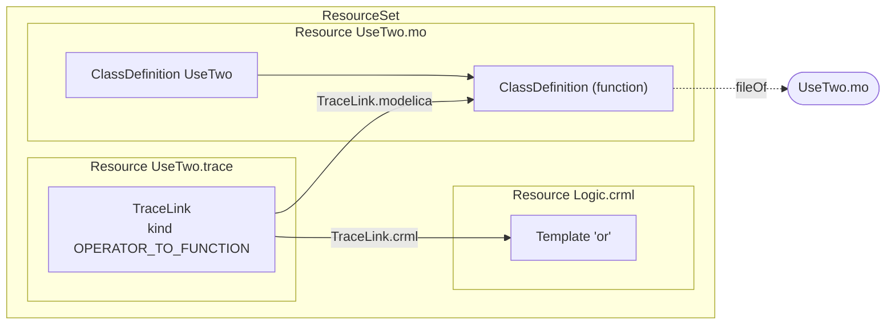

# Model expectations in VQL

Tests state facts about built and linked EMF models with **VIATRA's validation
framework**: `.vql` files in the VIATRA Query Language whose patterns annotated
`@Constraint` describe *violations*. A case passes when no constraint of severity `error`
has a match. The engine, `org.openmodelica.crml.testutil.vql.VqlEngine`, parses the file
at test run time (no code generation), runs the constraints with VIATRA's
`ValidationEngine` against a `ResourceSet`, and returns one result per constraint, which
the test shows as a table in its report.

```
// class_extends/expected.vql
// The model class Pump extends Machine, which lives in the library Equipment.
@Constraint(key = {n}, severity = "error", message = "found $n$, expected exactly 1")
pattern Class_Pump_superClasses_has_Class_Machine(n : java Integer) {
    n == count find Class_Pump_superClasses_has_Class_Machine_matches(_);
    check(n != 1);
}

pattern Class_Pump_superClasses_has_Class_Machine_matches(pump : Class) {
    Class.name(pump, "Pump");
    Class.name(machine, "Machine");
    Class.superClasses(pump, machine);
}
```

Users:

- `LibraryLoadingTest` and `IncompleteModelTest` in `:language` (through
  `CaseFolderTest`) evaluate `expected.vql` of each case on the linked DOM, with the
  CRML metamodel.
- `LibraryLoading` in `:compiler` evaluates `translation.vql` of each case on the DOM
  and the translation (see [Checking a translation](#checking-a-translation)), with the
  CRML, Modelica and trace metamodels.

This replaces the earlier home-grown constraint language (`*.constraints`,
`CONSTRAINT_LANGUAGE.md`). The corpus was translated by a one-off converter; see
[Migration](#migration-from-the-constraint-language).

## File format

```
package expectations;

import "http://www.eclipse.org/emf/2002/Ecore";
import "org.openmodelica.crml.model.metamodel" as model;
import "org.openmodelica.crml.modelica.metamodel" as modelica;
import "org.openmodelica.crml.modelica.trace.metamodel" as trace;

// comments are // or /* */
@Constraint(key = {x}, severity = "error", message = "...")
pattern someName(x : SomeClass) {
    ...
}
```

- **Package.** Always `expectations`, the package of the [library](#the-library); then
  its patterns are called by their simple names, with no `import pattern`.
- **Imports.** The nsURIs of the metamodels used. An alias (`as model`) is needed only to
  qualify a class name that two imported packages declare (`modelica::BooleanLiteral`).
  Ecore is imported for `EObject`.
- **File name.** VIATRA requires a valid Java type name: `expected.vql` and
  `translation.vql` are fine, `expected-dom.vql` is not.
- **Constraints and helpers.** A pattern with `@Constraint` is checked; a pattern
  without it is a helper and is only reported if it has an error.

### `@Constraint`

VIATRA's own annotation for validation constraints. Each match of the pattern is a
violation.

| Parameter | Meaning |
|---|---|
| `key = {a, b}` | the parameters that identify a violation (required); matches with the same key are one violation |
| `message = "..."` | the violation's message (required); `$a$` inserts parameter `a`, `$a.name$` a feature of it |
| `severity = "error"` | `error` (default) fails the test; `warning` and `info` are reported as `warn` and do not |

VIATRA's code generator normally turns each `@Constraint` into a Java class. Since the
files are parsed at run time, `PatternConstraint` reads the annotation of the parsed
pattern instead and gives it to the validation engine. A malformed annotation (missing
key or message, a key that is not a parameter, an unknown severity or parameter) is an
`error` result.

## Writing expectations

VQL patterns are conjunctions of constraints over variables; `or { }` adds a body (a
disjunction), `neg find` negates a pattern call, `count find` counts its matches, and
`check(...)` tests an expression over data values. See the
[VIATRA query language documentation](https://www.eclipse.org/viatra/documentation/query-language.html)
and the [validation framework](https://www.eclipse.org/viatra/documentation/addons.html#viatra-validation).

A constraint states what must *not* happen. The idioms the corpus uses:

| Fact | Constraint | Violation |
|---|---|---|
| nothing has property P | `pattern p(x) { …P… }`, `key = {x}` | each `x` with P |
| *every* object with … has P | `pattern p(x) { … and not P }`, `key = {x}` | each counterexample `x` |
| there are exactly n objects/values with … | `pattern p(n : java Integer) { n == count find matches(_); check(n != 3); }` with a helper `matches`, `key = {n}` | the wrong count |
| *the* object with … has P | the same with `check(n != 1)`, `matches` = objects with … and P | the wrong count |
| *some* object with … has P | the same with `check(n < 1)` | the count 0 |
| a navigation reaches exactly one value, x | `X.f(o, x); 1 == count find path(o, _);` | |
| a navigation does not reach x | `neg find path(o, x);` with a helper `path` | |

`count find` takes a pattern call, not inline constraints, so a counted set is a helper
pattern of its own (`<name>_matches` in the corpus). A match is a distinct tuple of the
pattern's **parameters**; local variables are projected away. So the parameters of the
helper decide what is counted: `matches(c : Class)` counts classes, `matches(n)` with
`n` a name counts distinct names.

Examples from the corpus:

```
// two_libraries: no reference in UseTwo.mo points into another file.
@Constraint(key = {reference}, severity = "error", message = "must not exist")
pattern count_Reference_not_UseTwo_mo_is_0(reference) {
    Reference(reference);
    find fileOf(reference, "UseTwo.mo");
    Reference.target(reference, target);
    find fileOf(target, file);
    file != "UseTwo.mo";
}

// local_and_library: some operator declared in MixLocal calls into Logic.
@Constraint(key = {n}, severity = "error", message = "found $n$, expected at least 1")
pattern some_MixLocal_CustomOperator_definition_operator_root_name_is_Logic(n : java Integer) {
    n == count find some_MixLocal_CustomOperator_definition_operator_root_name_is_Logic_matches(_);
    check(n < 1);
}

pattern some_MixLocal_CustomOperator_definition_operator_root_name_is_Logic_matches(customOperator : CustomOperator) {
    Model.name(mixLocal, "MixLocal");
    CustomOperator(customOperator);
    find containerOf+(customOperator, mixLocal);
    CustomOperator.definition(customOperator, definition);
    ComputedValue.operator(definition, operator);
    find rootOf(operator, root);
    find nameOf(root, "Logic");
}

// two_libraries: every trace link of UseTwo.trace to an operator of Logic is of kind
// OPERATOR_TO_FUNCTION. The counterexamples: an operator with a link of another kind,
// or with no link of that kind at all.
@Constraint(key = {customOperator}, severity = "error", message = "counterexample")
pattern all_CustomOperator_Logic_referrers_TraceLink_kind_is_OPERATOR_TO_FUNCTION(customOperator : CustomOperator) {
    CustomOperator(customOperator);
    find containerOf(customOperator, container);
    Library.name(container, "Logic");
    find traceLinkOf(customOperator, traceLink);
    find fileOf(traceLink, "UseTwo.trace");
    TraceLink.kind(traceLink, kind);
    kind != TraceLinkKind::OPERATOR_TO_FUNCTION;
} or {
    CustomOperator(customOperator);
    find containerOf(customOperator, container);
    Library.name(container, "Logic");
    neg find all_CustomOperator_Logic_referrers_TraceLink_kind_is_OPERATOR_TO_FUNCTION_path(customOperator, TraceLinkKind::OPERATOR_TO_FUNCTION);
}

pattern all_CustomOperator_Logic_referrers_TraceLink_kind_is_OPERATOR_TO_FUNCTION_path(o : CustomOperator, v) {
    find traceLinkOf(o, traceLink);
    find fileOf(traceLink, "UseTwo.trace");
    TraceLink.kind(traceLink, v);
}

// at the end of the file: the trace links that refer to o, through either end
pattern traceLinkOf(o : EObject, value : EObject) {
    TraceLink.crml(value, o);
} or {
    TraceLink.modelica(value, o);
}
```

Things to know:

- `Class.feature(x, y)` also makes `x` a `Class`; a separate `Class(x);` is only needed
  when nothing else types the variable.
- A feature is written with a class that has it: `ComputedValue.operator`, not
  `Value.operator`. Writing the subclass is a type test at the same time (a `Sequence`
  has no `operator`, so it does not match).
- Enum literals are written `Enum::LITERAL`, e.g. `TraceLinkKind::MODEL_TO_CLASS`.
- Operations of the metamodel cannot be called. `CustomOperator.keywords` is `header`
  filtered to `Keyword`: `Template.header(t, k); Keyword(k); Keyword.keyword(k, "'or'");`.
- `eval(...)` and `check(...)` accept only variables of data types (strings, numbers), not
  model objects; the [library](#the-library) covers what Java code would otherwise do.
- Every variable that occurs once must start with `_` (or be `_`); VIATRA warns otherwise.
  Warnings never fail a test.

## The library

`EmfLibrary` generates, from the metamodels the engine is given, patterns for facts that
are not features of any metamodel. They are in package `expectations` and available in
every file:

| Pattern | Holds when |
|---|---|
| `containerOf(o, container)` | `container` holds `o` in a containment reference (one body per containment reference of the metamodels) |
| `rootOf(o, root)` | `root` is the top of `o`'s containment tree; an object without container is its own root |
| `fileOf(o, name)` | `name` is the file name (last URI segment) of the resource holding `o`'s root |
| `referrerOf(o, referrer)` | `referrer` holds `o` in a non-containment, non-derived reference, whatever its name (one body per such reference) |

`find containerOf+(o, ancestor)` is VQL's transitive closure: `ancestor` contains `o` at
any depth.

A resource is not an `EObject`, so VQL cannot see it. For `fileOf` the engine builds a
small index model (package `http://openmodelica.org/crml/testutil/files`, one
`File { name; roots }` per resource) in a resource set of its own and gives the query
engine both; the models are not changed.

A file may add its own helpers. The converter emitted these kinds:

- `<constraint>_matches(...)`: the objects or values a count constraint counts;
- `<constraint>_path(o, v)`: the values a navigation reaches from `o`, for `neg find` and
  `count find`;
- `<feature>Of(o, value)` at the end of a file, for a step that features of several
  classes answer, e.g. `nameOf` over `NamedEntity.name` and `LibraryDependency.name`;
  and `<class>Of(o, referrer)` for the objects of a class that refer to `o` through any
  of its references, e.g. `traceLinkOf` over `TraceLink.crml` and `TraceLink.modelica`.

## Results

| Status | Meaning |
|---|---|
| `pass` | the constraint has no violation |
| `fail` | a constraint of severity `error` has violations; the detail lists the first 5 as message and key, e.g. `found 2, expected exactly 1 (n = 2)` or `must not exist (reference = Reference (UseTwo.mo))` |
| `warn` | a constraint of severity `warning` or `info` has violations; does not fail the test |
| `error` | the pattern does not parse or validate (unknown class or feature, type error), its `@Constraint` is malformed, or evaluation threw; also an error outside every pattern (package, import) |

An error in one pattern does not stop the others. A helper with an error is reported
too, and so is every constraint that calls it.

### Report

One table per file (`Expectations` in `:language`, `Translation expectations` in
`:compiler`):

| # | Constraint | Severity | Status | Detail |
|---|---|---|---|---|
| 8 | `Class_Pump_superClasses_has_Class_Machine` ▸ | error | pass | |

`#` is the line of the pattern name. The pattern's source is folded under its name.

## Checking a translation

`LibraryLoading` in `:compiler` evaluates the `translation.vql` file of a
`testModels/library-loading` case on the result of translating it:

1. one `CrmlWorkspace` per case, with the case folder as library path;
2. every valid model of the case is translated in it;
3. each translation is added to the resource set as two resources: `<Model>.mo` holds the
   generated Modelica class, `<Model>.trace` the trace;
4. the file is evaluated with the CRML, Modelica and trace packages.

A `TraceLink` refers to a CRML object (`crml`) and to what was generated for it
(`modelica`), with a `kind`. The translation reads the libraries' own objects, so the
`crml` end of a link into a library is the object in the library's resource; navigating
`TraceLink.crml` backwards leads from it to its links:



The usual constraints of a case, per model (here `UseTwo`):

```
// nothing dropped at any depth
@Constraint(key = {traceLink}, severity = "error", message = "must not exist")
pattern count_TraceLink_UNSUPPORTED_is_0(traceLink) {
    TraceLink(traceLink);
    find fileOf(traceLink, "UseTwo.trace");
    TraceLink.kind(traceLink, TraceLinkKind::UNSUPPORTED);
}

// exactly one generated class per model, operator and class it reaches
@Constraint(key = {n}, severity = "error", message = "found $n$, expected 3")
pattern count_ClassDefinition_is_3(n : java Integer) {
    n == count find count_ClassDefinition_is_3_matches(_);
    check(n != 3);
}

pattern count_ClassDefinition_is_3_matches(classDefinition) {
    ClassDefinition(classDefinition);
    find fileOf(classDefinition, "UseTwo.mo");
}
```

Links are filtered by `fileOf(link, "<Model>.trace")`: when several models of a case use
a library, each of its elements has a link from each model's trace.

A construct the translation drops leaves a `Placeholder` in the class and a link of kind
`UNSUPPORTED` from the CRML object the diagnostic is about, so some translation
diagnostics are visible to constraints (see `unresolved_name_in_library`).

## Dependencies

`:util-test` has these `api` dependencies:

- `org.eclipse.viatra:viatra-query-language`: the generic, run-time API, parser plus
  query engine;
- `org.eclipse.viatra:org.eclipse.viatra.addon.validation.core`: the validation framework,
  headless. Its Eclipse integration (`addon.validation.runtime`: annotation registry,
  problem markers) needs the workbench and is not used;
- `org.eclipse.viatra:viatra-transformation-runtime`: EVM, on which the validation
  engine runs.

Versions and alignment:

- **VIATRA 2.8.2**, the last release built for Java 8. VIATRA 2.9 needs Java 11 and
  Xtext 2.35.
- VIATRA is published only to `https://repo.eclipse.org/content/repositories/viatra2-releases/`.
  The root build declares it for all projects, restricted to the `org.eclipse.viatra`
  group.
- **Xtext 2.25.0**. VIATRA 2.8 is built against Xtext 2.20, and `:model` holds
  `org.eclipse.xtext.xbase.lib` strictly at 2.25.0 (`xbaseLibVersion`, the last Java 8
  release). `:util-test` declares dependency constraints that align the other Xtext
  artifacts with it. Constraints, unlike a resolution strategy, also apply to the test
  classpaths of `:language` and `:compiler`.
- **ASM 9.7.1**. Xtext reads JDK class files (for `java.lang.Override`) with ASM; the 9.1
  it asks for cannot read Java 21 class files.
- **antlr-runtime 3.2**, which Xtext's parsers are generated for.

Everything stays on Java 8 bytecode; the tests run on the JDK that runs Gradle.

## Limitations and differences from the constraint language

- **Two-valued.** The constraint language had *unresolved* as a third value, so a chain
  that could not be followed failed a check even under `all`. A VQL navigation that finds
  nothing simply does not match. A counterexample constraint usually still reports an
  object whose navigation is broken, because the negated helper does not match it; but
  there is no separate "unresolved" diagnosis.
- **No definite descriptions.** `[Model::name == "Second"] / [Variable…]` required exactly
  one `Second`; in VQL a selector is just a constraint and several matches are joined.
  The corpus's own count constraints ("what is quantified over") cover this.
- **No vacuity warning.** An `all` over an empty set passed and was flagged in the
  report; a counterexample constraint over an empty set just has no violation. Pair it
  with a count constraint, as the corpus does.
- **Double negation.** Every fact is written as what violates it, and counted facts need
  a helper pattern for `count find`, so files are longer than the one-line constraints.
- **Static types.** Every navigation names a class. A path whose classes are only known
  at run time (after `rootOf`, `containerOf` or a reference typed `EObject`) needs a
  helper with one body per possible feature (`nameOf`).
- **Dynamic metamodels.** VIATRA types attributes by their Java class, so an attribute
  whose type is a *dynamic* `EEnum` (one built in code, without generated classes) cannot
  be used. The CRML metamodels are generated, so this only matters for unit tests.
- **Start-up cost.** Xtext and VIATRA initialise once per JVM (a few seconds), and each
  file is parsed per test.

## Migration from the constraint language

A one-off converter (not kept in the tree) translated every `*.constraints` file of the
corpus, 817 constraints in 64 files, using the old parser and the metamodels for static
types:

| Constraint | Constraint pattern | Violation |
|---|---|---|
| `X cond` | count of the objects of X for which cond holds, `check(n != 1)` | the count |
| `some X cond` | the same, `check(n < 1)` | the count 0 |
| `all X cond` | the objects of X for which cond fails | each counterexample |
| `count X == 0` | the values X reaches | each value |
| `count X op n` | count of the values X reaches, `check` of the opposite of `op n` | the count |

Selectors became type and feature constraints, `/` became `find containerOf+`, `.@root`,
`.@container`, `.@file` and `.@referrers` became the [library](#the-library) patterns
(`.@referrers[TraceLink::…]` the reverse navigation of the `TraceLink` references that
can point at the object), and the `keywords` operation became `header` filtered to
`Keyword`. Pattern names are built from the words of the constraint.

The translation was checked against the old engine before it was removed, on the
resource set of every `library-loading` case (DOM and translation):

- all 800 constraints of those cases got the same verdict from the old engine and from
  their constraint pattern;
- so did a mutant of each (condition inverted, count shifted): 760 of the mutants fail
  in both, the other 40 pass in both (e.g. an `all` over an empty set). So the patterns
  are not vacuously satisfied where the constraints were not;
- the test suites gave the same results as before: `:language` 40 of 40 cases pass,
  `:compiler` `LibraryLoading` 23 of 24, with the same known failure
  (`model_union_model`: the class of `Derived` is expected `partial` and is not).

The 17 constraints of `testModels/incomplete` were only compared through the test
results (all pass in both).
