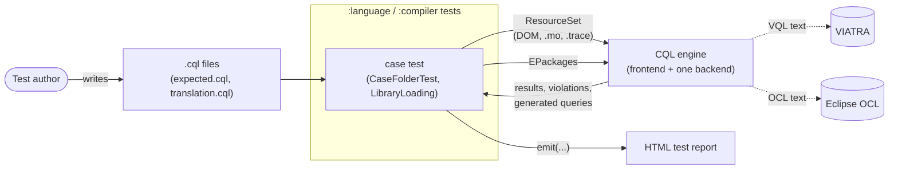
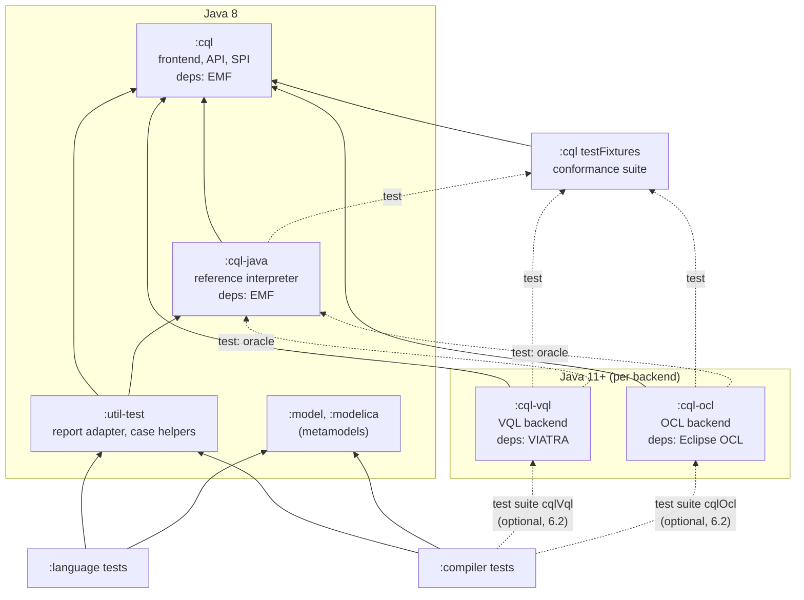
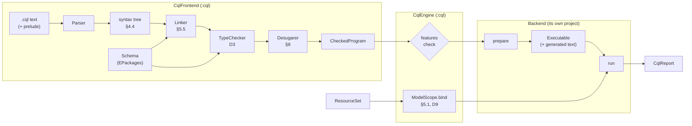
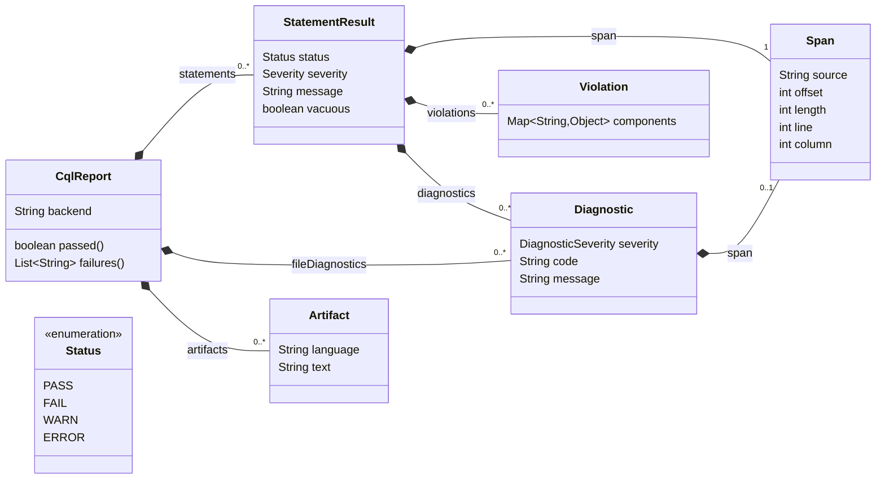
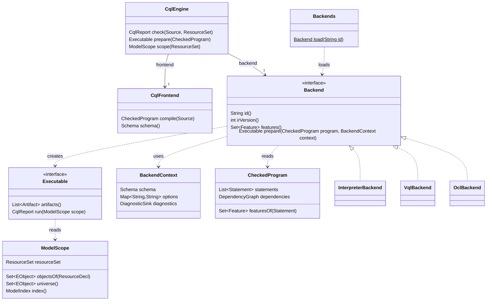
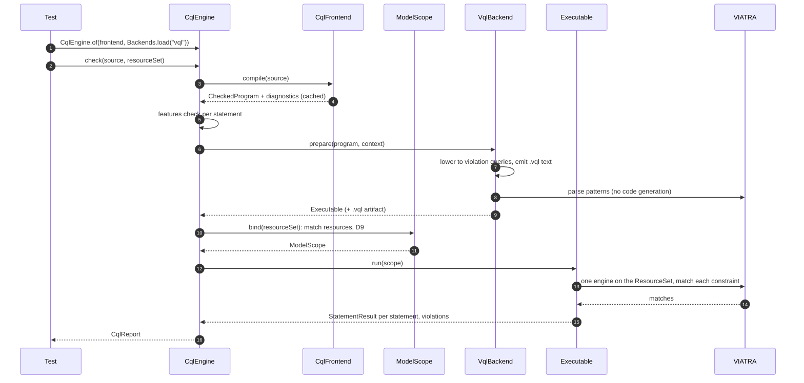

# Model query language: software architecture

Status: **draft, 2026-11-27**. Companion to [QUERY_LANGUAGE_SPEC.md](QUERY_LANGUAGE_SPEC.md)
(the *spec*), which defines what CQL means. This document defines how the implementation
is built: its modules, the interfaces between them, how a backend is assigned to an
engine, and how the backends are kept equivalent. Section numbers like §6.4 refer to the
spec; A1, A2, … are this document's decisions (section 9). Nothing is implemented yet.

The structure follows arc42, cut down to what a library of this size needs.

## 1. Goals and constraints

### 1.1 Quality goals, in priority order

| # | Goal | What it means here |
|---|---|---|
| Q1 | **One meaning, many backends** | Every backend gives the same verdict on every statement as the reference interpreter. A backend that cannot express a statement says so; it never answers differently. |
| Q2 | **Extensible** | A backend (native Java, VQL, OCL, later SPARQL, Cypher, generated Java) is a module that implements one interface and passes one conformance suite. Nothing else changes. |
| Q3 | **Useful failures** | Every problem is a diagnostic with a span in the `.cql` text. One bad statement does not hide the results of the others (§6.5). |
| Q4 | **Independent of the metamodel** | The engine knows `EPackage`s, `EClass`es and features, nothing about CRML (spec goal 4). |
| Q5 | **Light where it must be** | The frontend and the reference interpreter run on Java 8 with EMF as their only dependency. Each other backend picks its own JVM level and dependencies, and they reach a classpath only when that backend is chosen. |

### 1.2 Constraints

| Constraint | Source | Consequence |
|---|---|---|
| Java 8 bytecode and API for the frontend (`:cql`) and the reference interpreter (`:cql-java`) | the compiler runs on a Java 8 JRE | no `var`, records, `sealed`, modules in these two projects |
| Other backends may need a newer JVM | VIATRA 2.9 and later need Java 11 and Xtext 2.35 | each backend project sets its own `options.release`, overriding the root build's `release.set(8)` |
| Tests run on the JDK that runs Gradle, 17 or later (Gradle 9.1) | root `build.gradle.kts` | a Java 11 or 17 backend loads in-process in the test JVM; Java 8 is a limit for production code, not for tests |
| `:model` holds `org.eclipse.xtext.xbase.lib` strictly at 2.25, the last Java 8 release | `submodules/model/build.gradle.kts` | a classpath with the CRML metamodels cannot also hold Xtext 2.26 or later without overriding that pin (section 6.2) |
| EMF 2.33 / Xcore 1.21, built with `org.xtext.builder` | root build, `:model` | the syntax tree and the IR are Xcore models, built the way `:model` is |
| Tests report through `ReportedTest.emit` and `CustomHtmlReporter` | `:util-test` | results are rendered as j2html tables, as `ConstraintTable` does now |

## 2. Context



The engine has one kind of client, a test that owns a `ResourceSet` and a `.cql` file,
and talks to external query engines only through backends.

## 3. Solution strategy

The engine is a **compiler pipeline with pluggable backends** (ports and adapters). The
shape is the one of LLVM, Calcite or Kodkod: a shared frontend lowers the text to a
small typed IR, and each backend translates or interprets only that IR.

| Problem | Approach | Decision |
|---|---|---|
| Many backends, one meaning | Parsing, name resolution, typing and desugaring happen once, in the frontend. Backends see only the checked IR (§8). | A1 |
| Backends must agree | A reference interpreter that follows §6 literally is the oracle; every backend runs a shared conformance suite against it (§9.5). | A5 |
| The frontend must not depend on any backend | The frontend and the reference interpreter are separate blocks; the frontend contains no backend at all. | A11 |
| An engine needs exactly one backend | An engine is assembled from a frontend and a backend given to it explicitly; there is no default inside the frontend. | A3 |
| Backends differ in what they can express | Each backend declares its **features**; the engine refuses statements a backend cannot express, before the backend sees them. | A4 |
| Backends need other JVMs and dependency stacks | One Gradle project per backend, each with its own Java level; the frontend's API is Java 8, which every later JVM runs. | A2, A12 |
| Resources mean the same everywhere | Resource matching (§5.1, D9) and the built-in relations' indices are done by the frontend, once per model set, and handed to backends. | A6 |
| Failures in one statement | Results and diagnostics per statement; no stage throws for a problem in the input. | A7 |

## 4. Building blocks

### 4.1 Gradle projects



| Project | Contents | Java | Depends on |
|---|---|---|---|
| `:cql` (`submodules/cql`) | the **frontend**: syntax tree, parser, IR, semantic analysis, `ModelScope`; the API (`CqlFrontend`, `CqlEngine`, results); the backend SPI | 8 | EMF; `org.xtext.builder` at build time only |
| `:cql` test fixtures | the conformance suite (TCK, section 8): harness, test metamodel, cases | 8 | `:cql`, JUnit 5 |
| `:cql-java` | the **reference interpreter**, backend id `java` | 8 | `:cql`, EMF |
| `:cql-vql` | the VQL backend | 11 or later | `:cql`, current VIATRA |
| `:cql-ocl` | the OCL backend | as its OCL release needs | `:cql`, Eclipse OCL |
| `:util-test` | `CqlTable` (`CustomHtmlReporter`), helpers for case folders, backend selection | 8 | `:cql`, `:cql-java` |

Rules:

1. Arrows point from user to used. `:cql` depends on no backend and contains none, not
   even the reference interpreter (A11).
2. A backend never depends on another backend at compile time. Its tests use `:cql-java`
   as the oracle; that is a test dependency and needs only Java 8 and EMF.
3. What two backends share (e.g. the violation lowering of §9.2) lives in `:cql`.
4. A project's Java level is the lowest its dependencies allow, and never lower than the
   projects it depends on. `:cql` and `:cql-java` stay at 8 so that production code may
   use them.
5. `:util-test` depends on `:cql-java`, so the corpus tests have a backend without
   choosing one; it is `:util-test` that makes the interpreter the default, not `:cql`.

The new projects go under `submodules/`, where `settings.gradle.kts` already maps every
project. The engine is not CRML-specific, so it is not part of `:util-test`; it can
later be published or moved out of the repository without touching the tests.

### 4.2 Packages

`:cql`, base package `org.openmodelica.crml.cql`:

| Package | Role | Used by |
|---|---|---|
| `api` | `CqlFrontend`, `CqlEngine`, `Backends`, `Source`, `CqlReport`, `StatementResult`, `Violation`, `Diagnostic` | tests |
| `spi` | `Backend`, `Executable`, `Feature`, `BackendContext` | backends |
| `syntax` | the syntax tree (Xcore, §4.4), `Lexer`, `Parser`, `Span` | frontend; read-only for others |
| `ir` | the IR (Xcore, §8), `IrPrinter`, `IrSwitch` (generated) | backends |
| `ir.lowering` | shared rewritings for generating backends: negation normal form, violation queries (§9.2), `let` inlining | generating backends |
| `sema` | `Linker` (§5.5), `TypeChecker` (D3), `Desugarer` (§8 table), `DependencyGraph` (§5.2 cycles), `Lints` (§7 warnings) | internal |
| `schema` | `Schema`: `EClass`/feature/enum lookup over the given `EPackage`s, least common supertype (D3) | backends |
| `scope` | `ModelScope`: the `ResourceSet`, resource matching (§5.1), resource providers (§9.4), `ModelIndex` for `@container` and `@referrers` | backends |

`:cql-java`, package `org.openmodelica.crml.cql.interpreter`: `InterpreterBackend` (the
public entry), the evaluator, the violation builder. Internal packages are marked as such
in `package-info.java` (Java 8 has no module system to enforce it).

### 4.3 The pipeline



The frontend depends on the text and the metamodels only; it runs once per file and its
result, `CheckedProgram`, is immutable and can be shared by engines, backends and
threads. `ModelScope` depends on the model set and is built once per `ResourceSet`.

Every stage takes what the previous one produced and adds diagnostics; none throws for a
problem in the input (A7). A statement with an `error` diagnostic, or one that uses a
declaration with an error, is not passed on; it ends as status `error` with that
diagnostic.

## 5. Interfaces

### 5.1 Assembling an engine

An engine is **one frontend and one backend**, both given at construction and fixed for
the engine's life (A3):

```java
CqlFrontend frontend = CqlFrontend.builder()
        .metamodels(CRMLPackage.eINSTANCE, ModelicaPackage.eINSTANCE, TracePackage.eINSTANCE)
        .prelude(Source.of(PRELUDE))   // optional, spec open point 4
        .build();

// By type: the caller depends on the backend's project at compile time.
CqlEngine engine = CqlEngine.of(frontend, new InterpreterBackend());

// By id: the backend's project is only on the runtime classpath.
CqlEngine engine = CqlEngine.of(frontend, Backends.load("vql"));
```

- **No default.** `CqlEngine.of` requires a backend; `:cql` has none to fall back to.
  Defaults are a decision of the caller: `:util-test` uses `InterpreterBackend` unless
  the system property `cql.backend` names another.
- **By type or by id.** Code that always wants one backend names its class. Code that
  lets configuration choose calls `Backends.load(id)`, which uses `ServiceLoader`
  and fails with a clear message, not a `ServiceConfigurationError`, when
  - no backend has that id (`backend-not-found`: the project is not on the classpath);
  - the backend's classes need a newer JVM (`backend-incompatible`: an
    `UnsupportedClassVersionError` while loading, reported with the running Java
    version);
  - the backend was built against another major version of the IR
    (`backend-incompatible`: `Backend.irVersion()` differs from the frontend's).
- **One frontend, many engines.** A frontend caches `CheckedProgram`s by source content,
  so engines that share it compile each file once. Cross-checking (section 8) is several
  engines on one frontend.
- **Immutable.** `CqlFrontend` and `CqlEngine` are immutable and thread-safe; what a
  backend caches lives in its `Executable` (5.4).

### 5.2 Running

```java
CqlReport report = engine.check(Source.of(caseDir.resolve("translation.cql")), resourceSet);
emit(CqlTable.of(report), "Translation expectations");
report.failures().forEach(failures::add);
```

`check` is the composition of steps that tools may also call one by one:

```java
CheckedProgram program = engine.frontend().compile(source);  // parse + semantic analysis
Executable executable  = engine.prepare(program);            // features check + backend
CqlReport report       = executable.run(engine.scope(resourceSet));
```

### 5.3 Results



- `Status` and `vacuous` are those of §6.5; a `WARN` or `PASS` does not fail a test.
- A `Violation` holds the components of §9.2 (`x`, `side`, `n`, `a`, `k`, …) by name, in
  a fixed order; objects are sorted by resource URI and URI fragment, so reports are
  stable (A9).
- A `Diagnostic` has a stable `code` (`unknown-feature`, `type-mismatch`, `cycle`,
  `resource-not-found`, `unsupported-by-backend`, `backend-failure`,
  `backend-incompatible`, …), which tests and the conformance suite match on instead of
  the message.
- `Artifact` is what a generating backend produced (a `.vql` or `.ocl` text). The report
  adapter shows it, so a failing case shows the query that was run.

### 5.4 The backend SPI



`Feature` is an enumeration of the IR constructs some query language lacks: `UNIVERSE`,
`DECLARED_RELATIONS`, `BIDIRECTIONAL_RELATIONS`, `CLOSURE`, `INVERSE_FEATURE`,
`REFERRERS`, `SET_EQUALITY`, `ORDER_COMPARISON`, `COUNT`, `LINK_COUNT`, `QUANTIFIERS`,
`VIOLATION_TUPLES`.

Contract of a backend:

1. **Identity.** `id()` is short and unique: `java`, `vql`, `ocl`. For selection by id,
   the project registers the class in
   `META-INF/services/org.openmodelica.crml.cql.spi.Backend` with a public no-argument
   constructor. `irVersion()` is the IR major version it was built against.
2. **Java level.** A backend may need a newer JVM than the frontend. It is then usable
   only in a JVM of that level; `Backends.load` reports the mismatch (5.1).
3. **Features.** `features()` lists what the backend can express. Before `prepare`, the
   engine computes `featuresOf(statement)` for each statement; a statement that needs a
   missing feature becomes `error` with `unsupported-by-backend` and is not given to the
   backend (A4).
4. **Input.** `prepare` sees only the `CheckedProgram`: IR, static types, dependency
   graph. It never sees the syntax tree or the text, except spans for messages.
5. **Granularity.** `prepare` and `run` handle statements one by one. An exception for a
   statement becomes `error` with `backend-failure` for that statement; the engine wraps
   each call as a second line of defence.
6. **Resources and built-ins.** The objects of a resource and the `@container` /
   `@referrers` indices come from `ModelScope` (A6). A backend that cannot take them as
   input (VQL) maps them to its own means and must agree with `ModelScope`; the
   conformance suite checks it.
7. **State.** An `Executable` may cache per `ModelScope` (a VIATRA engine, an OCL
   environment). It is not required to be thread-safe; `CheckedProgram` is.
8. **Conformance.** The backend's tests extend the conformance suite (section 8). A
   backend is selectable in CI only when it passes it, with the unsupported statements
   listed as expected.

## 6. Runtime view

### 6.1 A check with the VQL backend



With the reference interpreter, steps 7 and 8 do not happen (the executable just holds
the IR), and in steps 13 and 14 it evaluates the IR over `ModelScope` instead of calling
an external engine.

### 6.2 Where each backend runs

All backends run **in the test JVM**, in-process: the tests run on Gradle's JDK (17 or
later), which loads Java 8 and Java 11+ classes alike. What separates the backends is the
**classpath**, not the JVM:

| Run | Classpath | Backends |
|---|---|---|
| `:cql-java:test`, `:cql-vql:test`, `:cql-ocl:test` | the backend, `:cql`, its test fixtures, `:cql-java` as oracle; the TCK metamodel is dynamic EMF, so no `:model` | that backend |
| `:language:test`, `:compiler:test` (as now) | `:model` with `xbase.lib` 2.25, `:util-test`, `:cql-java` | `java`, and any backend whose dependencies agree with `:model` |
| `:compiler:cqlVqlTest` (a Gradle JVM test suite, optional) | as above, plus `:cql-vql`, with `xbase.lib` raised to the version VIATRA needs | `java` and `vql`, cross-checked |

The suite in the last row is the only place a newer Xtext meets the CRML metamodels. It
declares `xbase.lib` with a `strictly` of its own, which wins over the one `:model`
publishes (checked with Gradle 9.1: the suite's runtime classpath gets the newer
version, the main runtime classpath, and so `compiler-all.jar`, keeps 2.25). The pin
exists only for Java 8 class files: `:model`, `:modelica` and `:language` use
`Functions.Function0`, `IterableExtensions.size` and `IterableExtensions.head`, whose
signatures are the same in 2.25 and 2.45; Guava moves from 30 to 33 along with it.
Running the corpus on the newer version is still to be done (section 10). If it fails,
the fallback is to run such a backend out of process (section 11, open point 3); the
SPI does not change for that.

## 7. Backends

### 7.1 Reference interpreter (`:cql-java`, id `java`)

Follows §6 and §9.1 literally: one evaluation function per IR class (`IrSwitch`), sets
as `LinkedHashSet`, relations as maps with an inverse index built on first use. It
supports every feature and computes violations per §9.2 directly from the semantics,
**without** using `ir.lowering` (A5): if the shared lowering has a bug, the generating
backends disagree with the interpreter and the conformance suite finds it.

It is a block of its own (A11): Java 8, EMF only, so production code may use it, and
backends' tests can load it as the oracle without the frontend's tests depending on it.
It is fast enough for the test corpus, whose models have hundreds of objects. A faster
Java backend (IR compiled to closures, or to Java source) would be a separate backend,
checked against this one.

### 7.2 VQL (`:cql-vql`, id `vql`)

Uses the current VIATRA release on Java 11 or later; it is not held at 2.8.2 as the
`viatra-constraints` branch had to be. It reuses that branch's run-time setup
(`VqlEngine`, `EmfLibrary`, `PatternConstraint`): the backend writes one `.vql` text per
file, VIATRA parses it without code generation, and each assertion is a pattern with
`@Constraint` whose matches are the violations.

| IR | VQL |
|---|---|
| an assertion | a violation pattern from `ir.lowering` (§9.2), `@Constraint(key = …)` |
| `Filter`, `And`, `Or` | pattern bodies; `or { }` |
| `Not`, `Empty` | `neg find` |
| `Count`, `LinkCount` | helper pattern + `count find` + `check` |
| `Compare(EQ)` on sets | two `neg find` helpers (`A ∖ B`, `B ∖ A`) |
| `ResourceRef` | helper `inResource_<V>(x)` over `fileOf`; the resource names come from `ModelScope`, so matching is the frontend's (A6) |
| `BuiltinRel` | `containerOf`, `referrerOf` of `EmfLibrary` |
| `DeclaredRel` | a two-parameter pattern with one body per declaration |
| `Closure` | `find p+(x, y)` |

Gaps: VQL patterns are typed by `EClass`, so every navigation needs the static type
(D3 provides it); data values compared across `EDataType`s need `check` with
normalisation (§6.1).

### 7.3 OCL (`:cql-ocl`, id `ocl`)

Translates each assertion to an OCL expression and evaluates it with Eclipse OCL. OCL is
set-based and has quantifiers, so the mapping is close to §6:

| IR | OCL |
|---|---|
| `ResourceRef`, `LetRef` | a variable of type `Set(OclAny)` bound by the backend from `ModelScope` |
| `Universe` | the union of all resource variables (not `allInstances()`, which is per type and per resource set) |
| `Filter` | `->select(x \| …)`, with `oclIsKindOf`/`oclAsType` for `InstanceOf` |
| `Image(FeatureRel)` | `->collect(x \| x.f)->asSet()` |
| `Closure` | `->closure(…)` |
| `BuiltinRel CONTAINER` | `oclContainer()` |
| `BuiltinRel REFERRERS` | an operation the backend adds to the environment, backed by `ModelIndex` |
| `Quantified` | `->forAll`, `->exists`, `->reject(…)->isEmpty()` |
| violations | `->select(x \| not φ)` |

Gaps: OCL has `null` and `invalid` and a four-valued logic; CQL is two-valued with empty
sets (§6.1). The translation must turn every single-valued navigation into a set
(`->asSet()` maps `null` to `Set{}`) and must never let `invalid` reach a Boolean
operator. The conformance suite has cases for exactly these (unset references, unset
enums, `!=` on empty sets, §7).

Variant: Eclipse OCL comes in a *classic* form (Ecore binding, LPG parser, no Xtext) and
a *pivot* form (Xtext-based, the maintained one). Java 8 no longer decides between them.
The pivot form needs its own test suite next to `:model` like VQL does (6.2); the classic
form might share the corpus classpath. Which to use is decided by a spike (section 11).

### 7.4 Adding a backend

1. Create `:cql-<id>` depending on `:cql`, with the target engine's dependencies.
2. Set its Java level (`options.release`) to what those dependencies need.
3. Implement `Backend` and `Executable`; register the service.
4. Declare `features()` honestly; start small, the gate keeps the rest out.
5. Add a test class that extends `BackendConformanceTest` and returns the backend.
6. Run it; list the expected `unsupported-by-backend` cases in the test.
7. Document the IR mapping and the semantic gaps in a table like 7.2 and 7.3.
8. To run it on the corpus, add it to the existing tests if its dependencies agree with
   `:model`, or as a test suite of its own (6.2).

Nothing in `:cql`, `:cql-java` or `:util-test` changes.

## 8. Testing

| Level | Where | What |
|---|---|---|
| Unit | `:cql` tests | lexer, parser (syntax tree per grammar rule, spans), linker, type checker, desugarer (IR per row of the §8 table), lints, `Backends.load` errors |
| Golden | `:cql` tests | `IrPrinter` output for the spec's examples (§3.1, §3.2) |
| Conformance (TCK) | harness in `:cql` test fixtures; run by `:cql-java` and every backend | below |
| Integration | `:language`, `:compiler`, and their per-backend test suites (6.2) | the case corpus (`expected.cql`, `translation.cql`) |

**The conformance suite.** A self-contained metamodel built with dynamic EMF in the
fixture (classes, single and many references, containment, enums with an unset value,
`String`, `int`, `double`, `boolean` attributes), a few small models of it, and cases
`(cql text, model, expected status per statement, expected violations)`. The fixture
holds the harness and the cases, not a backend. `:cql-java`'s tests run it first: that
is where the expected results are checked against the spec. Each other backend runs the
same cases and, in addition, compares every statement live with `InterpreterBackend`
(its test oracle). Mutants of each case (condition negated, range or count shifted,
§9.5) must flip the verdict on every backend. The fixture has no CRML in it (Q4), so a
backend's conformance run never meets `:model`'s pinned Xtext.

**Cross-checking in the corpus.** Where two backends share a classpath (6.2), the
`:util-test` helper builds one engine per backend on one frontend and fails the test on
any disagreement in status, so the real corpus is an extra conformance test. With
`-Dcql.backends=java,vql` the per-backend suite runs that way. CI runs the corpus with
`java`, and each backend's suite in a separate job.

## 9. Decisions

| # | Decision | Why | Alternatives rejected |
|---|---|---|---|
| A1 | Backends get only the checked IR. | One implementation of name resolution, typing and desugaring; backends stay small (spec §8). | Backends translating the syntax tree: each would re-implement §5.5 and D3, and they would drift. |
| A2 | One Gradle project per backend; `:cql` depends on EMF only. | Backends bring VIATRA, Eclipse OCL and their Xtext versions; users load only what they choose (Q5). | One project with all backends: every classpath carries all engines, at the highest Java level any of them needs. |
| A3 | An engine is a frontend plus one backend, both given at construction; `:cql` has no default backend. Backends are given by instance or loaded by id with `ServiceLoader`. | The frontend cannot default to a backend it does not contain (A11); the choice is visible where it is made; one frontend serves several engines. | A default backend found on the classpath: which one runs would depend on the classpath, silently. A mutable `setBackend`: an engine's results would depend on when it was asked. |
| A4 | Backends declare features; the engine refuses statements that need a missing one. | A backend never gives a wrong answer for something it cannot express (Q1); partial backends are usable early. | Backends failing at run time: the failure would look like a bug, not a limit. |
| A5 | The reference interpreter is the oracle and shares no lowering with the generating backends. | A bug in shared code would make all backends agree on a wrong answer. | Testing each backend against hand-written expectations only: more work, less coverage. |
| A6 | Resource matching and built-in indices are computed by the frontend (`ModelScope`). | §5.1 and D9 must mean the same on every backend; the indices are built once. | Each backend matching resources: three implementations of the glob rules. |
| A7 | Diagnostics, not exceptions, for problems in the input; isolation per statement. | §6.5: one broken line must not hide the other results (Q3). | Fail-fast parsing: the existing engine already reports per line and tests rely on it. |
| A8 | Syntax tree and IR as Xcore models in `:cql`. | Spec D11 and open point 2; the build already knows Xcore (`:model`); generated switches serve as visitors. | Plain Java classes: no reflection, no generated switch, no diagrams from the metamodel. |
| A9 | Deterministic results: statements in file order, violations sorted by URI and fragment. | Reports and golden tests must not change between runs or backends. | Engine order: VIATRA and OCL do not guarantee one. |
| A10 | The engine is its own set of projects, not part of `:util-test`. | It is metamodel-independent and could be published; `:util-test` is CRML test glue. | Keeping it in `:util-test`, as `*.constraints` is now. |
| A11 | The frontend (`:cql`) and the reference interpreter (`:cql-java`) are separate blocks. | The interpreter is a backend like the others and goes through the same SPI; the frontend can be used (e.g. for checking `.cql` files) without any evaluator; backends' tests use the interpreter without it being part of the API they implement. | The interpreter inside `:cql`: it would be a privileged default, and the SPI would not be exercised by the main backend. |
| A12 | Java 8 only for `:cql` and `:cql-java` (and what production code uses); every other backend picks its level. In-process by default; classpaths, not JVMs, separate the backends. | The compiler runs on Java 8; the tests run on Java 17+; VIATRA and OCL are current only on newer Java. | Everything on Java 8: VIATRA frozen at 2.8.2 with the Xtext/ASM/ANTLR alignment of the `viatra-constraints` branch. Every backend out of process: costly, and needed only if 6.2's override fails. |

## 10. Risks

| Risk | Effect | Mitigation |
|---|---|---|
| The CRML code fails at run time on the newer `xbase.lib` and Guava of a per-backend suite (the override and the API were checked, a run was not) | VQL (and pivot OCL) cannot run on the CRML corpus in-process | verify first (section 11, step 3); fallback: run the backend out of process (open point 3); conformance runs are unaffected, they do not use `:model` |
| A backend's semantics differ subtly (OCL `null`/`invalid`, VQL counting distinct tuples, numeric normalisation) | wrong verdicts | conformance cases aimed at each gap (7.2, 7.3); cross-checking on the corpus |
| Frontend and backend built from different IR versions | a backend misreads the IR | `Backend.irVersion()` checked at `CqlEngine.of` (5.1) |
| Spec changes after implementation | every backend must follow | the IR absorbs syntax changes; feature flags and the suite pin down semantic ones |
| Maintenance cost of several backends | backends rot | a backend not passing the suite is not selectable in CI; `java` remains the default |
| Performance of `@referrers` and `*` in OCL | slow tests | the frontend's `ModelIndex`; OCL gets it as an operation, not as an `allInstances()` scan |

## 11. Roadmap

1. **Frontend.** `:cql` with parser, syntax tree, IR, semantic analysis, `ModelScope`,
   the API and SPI, the conformance harness.
2. **Reference interpreter and migration.** `:cql-java`; `CqlTable` and backend selection
   in `:util-test`; a converter from `*.constraints` (spec §10); `CaseFolderTest` and
   `LibraryLoading` run `.cql` files. The old engine stays until the corpus gives the
   same results on both, then is removed.
3. **VQL backend.** First check the classpath question of 6.2 (a `cqlVqlTest` suite in
   `:compiler` with current VIATRA and `:model`). Then move the `viatra-constraints`
   infrastructure into `:cql-vql`, generate from `ir.lowering`, pass the suite,
   cross-check the corpus.
4. **OCL backend.** A spike: classic or pivot Eclipse OCL, which release, from Maven
   Central or the Eclipse repository (as VIATRA is). Then the backend.
5. **More backends** (SPARQL, Cypher, generated Java) as needed, by section 7.4.

Open points:

1. The parser: hand-written as now, ANTLR 4.9.2 (already a dependency of `:util-test`),
   or Xtext (spec open point 1). The architecture only fixes its output, the syntax tree.
2. Whether `Feature` should be finer than one flag per construct (e.g. `CLOSURE` only over
   features vs. over declared relations), once real backends show where they differ.
3. An out-of-process backend host, if 6.2's in-process suites do not work: a
   `RemoteBackend` in `:cql` that sends the `CheckedProgram` and the resources (as XMI)
   to a backend running in its own JVM. It needs the CRML models to round-trip through
   XMI, which is not known yet.
4. Whether a backend may *rewrite* an unsupported statement into a supported form (e.g.
   unfold a bounded closure) instead of refusing it; for now, no (A4).
