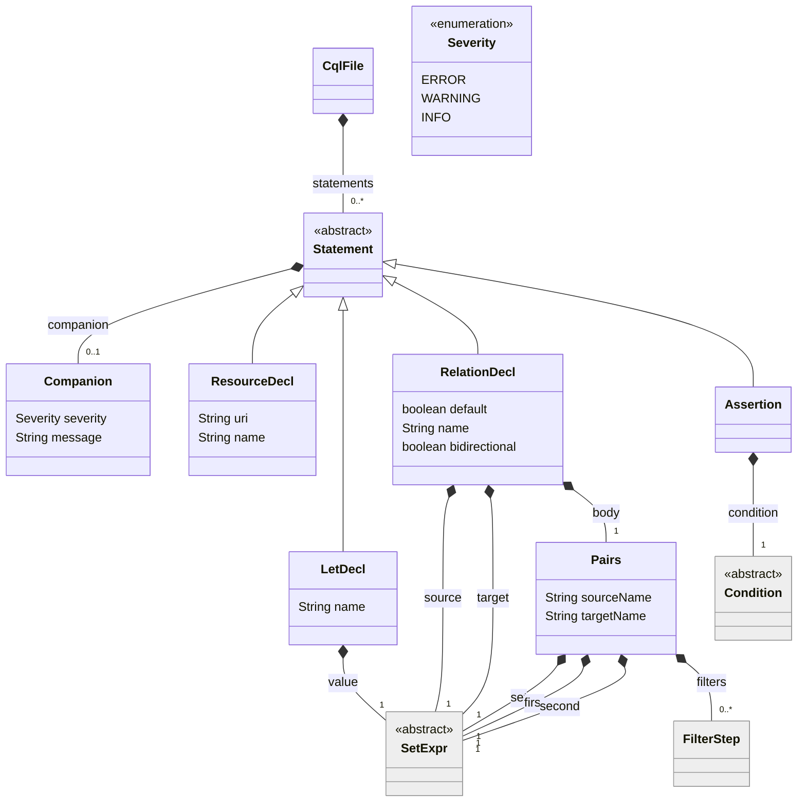
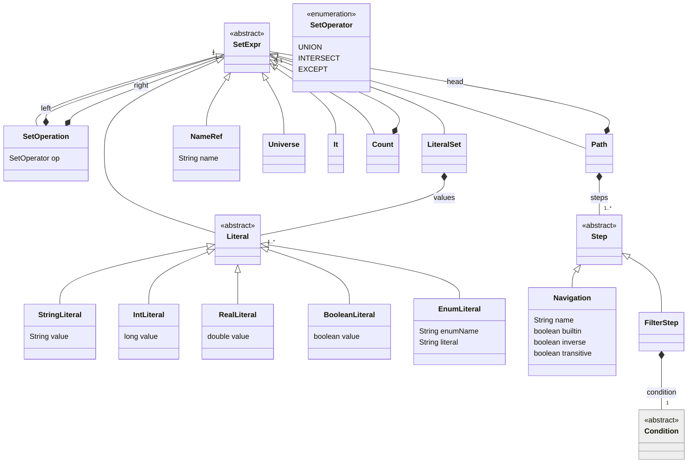

# Model query language: specification

Status: **draft, 2026-11-20**. Section 2 lists the decisions; those marked *locked* were
agreed and are not reopened without a reason, those marked *draft* were settled while
writing this text and are up for review. Nothing is implemented yet.

Working name **CQL**, file extension `.cql`. It is to replace the constraint language of
[CONSTRAINT_LANGUAGE.md](CONSTRAINT_LANGUAGE.md) (`*.constraints`) and the VQL expectations
of the `viatra-constraints` branch ([EXPECTATIONS.md](EXPECTATIONS.md)).

## 1. Goals

1. State facts about built and linked EMF models (the CRML DOM, the generated Modelica
   class, the trace of a translation) as test expectations, one fact per line.
2. A formal language: a grammar (section 4), a typed intermediate representation (IR,
   section 8) and a set-theoretic semantics (section 6) that does not depend on any
   engine.
3. Several evaluators of the same IR: a reference interpreter over EMF, and generated
   queries for other engines (VQL first; SPARQL and Cypher possible), see section 9.
4. Independent of the metamodel. The language knows `EClass`es, features and resources,
   nothing about CRML. Metamodel-specific helpers are declarations (section 5.4).

Out of scope: changing models, arithmetic, recursion other than transitive closure,
diagnostics (a backend concern, section 9.4), templates or macros (section 9.3).

## 2. Decisions

| # | Decision | |
|---|---|---|
| L1 | `resource("uri") as V` names the set of **all** objects contained in the resource, at any depth, roots included. | locked |
| L2 | `/` transforms a set: a filter `S/[...]` or a projection to pairs `S/<a, b>`. `.f` navigates. | locked |
| L3 | A filter is in disjunctive normal form: `,` is *and* inside a clause, `\|` is *or* between clauses, and each clause may name its own type: `[T::c1, c2 \| U::c3]`. | locked |
| L4 | Built-in relations carry the prefix `@`: `@container` and the ones derived from it (section 5.3). | locked |
| L5 | A relation is declared `S -[name]-> T := body` (directed) or `S -[name]- T := body` (bidirectional). | locked |
| L6 | Declared ends restrict the relation: pairs of the body outside `S × T` are dropped. | locked |
| L7 | Declaring a name again adds to the relation (union, an *or* of the bodies). If the declarations have different end types, the relation's end type is their common supertype. | locked |
| L8 | Relations are sets of pairs. Two links with the same ends are one pair. | locked |
| L9 | A directed relation is only navigated and counted in the direction it was declared. | locked |
| L10 | A link constraint without a relation name counts the union of the declared relations (see D2 for `default`). | locked |
| L11 | `S -[R m:n]-> T`: every element of `S` has a number of `R`-links into `T` in range `n`, every element of `T` has a number of `R`-links from `S` in range `m`. Only links between the two sets count. | locked |
| L12 | Shorthands: `S -[R n]-> T` is `[*:n]` (every element of `S` is mapped, no reverse guarantee); `S -[R n]- T` is `[n:n]` (so `-[1]-` is one-to-one). | locked |
| L13 | A link constraint over an empty side holds (a ∀ over the empty set). | locked |
| L14 | `==` and `!=` compare sets. | locked |
| L15 | Reuse of selectors (common subexpressions) is a backend concern, not a language feature. | locked |
| L16 | A statement may carry a companion `! severity "message"`, which backends read. | locked |
| L17 | One statement per line. The grammar allows line breaks (section 4.2); `;` ends a statement explicitly. | locked |
| L18 | Diagnostics are not part of the language. A backend may offer them through a resource provider. | locked |
| D1 | Name CQL, extension `.cql`; one `expected.cql` / `translation.cql` per case, as now. | draft |
| D2 | `default` modifier: if a file marks any relation `default`, the unnamed union is the union of the `default` relations; otherwise it is all declared relations (L10). Lets helper relations (e.g. `keywords`, section 5.4) stay out of unnamed link constraints. | draft |
| D3 | Static typing: every set has a static type; a feature must exist on it; `/[T]` narrows. The common supertype of L7 is the least common supertype, `EObject` only when there is no narrower one. | draft |
| D4 | Inside a filter or projection, `.f` and `@x` start at the current element, `it` is the current element, and a bare name is a binding (resource, `let`, variable). | draft |
| D5 | `A in B` is `A ⊆ B`, `A contains B` is `B ⊆ A`. | draft |
| D6 | `<`, `<=`, `>`, `>=` hold only between two one-element sets of comparable values. | draft |
| D7 | `count(S)` is the one-element set `{|S|}`, so `count(S) == 3` is a set comparison like any other. | draft |
| D8 | EOperations cannot be navigated. Helpers that would call one are declared relations (section 5.4). | draft |
| D9 | A resource string that matches no resource is an error, not an empty set. | draft |
| D10 | Link constraints are ordinary conditions, so they can appear inside quantifiers and filters. | draft |
| D11 | The syntax tree is an Ecore model (section 4.4) that keeps the text's sugar and holds names as strings; resolution and desugaring happen on the way to the IR (section 8). | draft |

## 3. The language by example

### 3.1 A DOM case

`library-loading/class_extends`: the class `Pump` of the model extends `Machine` of the
library `Equipment`.

```
resource("ExtendClass.crml") as M
resource("Equipment.crml")   as EQ

let pump    = M/[Class::.name == "Pump"]
let machine = EQ/[Class::.name == "Machine"]

count(pump) == 1                     # what the facts below are about exists, once
count(machine) == 1
pump.superClasses contains machine   # Pump extends Machine ...
pump.superClasses in EQ              # ... and every superclass lives in Equipment
```

### 3.2 A translation case

`library-loading/unrelated_broken_file`: `UseLogic` uses the library `Logic`; `Broken.crml`
is broken and unrelated. `UseLogic.mo` is the generated Modelica class, `UseLogic.trace`
the trace.

```
resource("UseLogic.crml")   as CRML
resource("Logic.crml")      as LOGIC
resource("Broken.crml")     as BROKEN
resource("UseLogic.mo")     as MO
resource("UseLogic.trace")  as TR

# Trace relations, one per link kind, and one for links of any kind.
default *                        -[traced]->      MO := TR/[TraceLink]/<.crml, .modelica>
default CRML/[Model]             -[toClass]->     MO/[ClassDefinition] :=
            TR/[TraceLink::.kind == MODEL_TO_CLASS]/<.crml, .modelica>
default CRML/[Variable]          -[toComponent]-> MO/[ComponentDeclaration] :=
            TR/[TraceLink::.kind == VARIABLE_TO_COMPONENT]/<.crml, .modelica>
default LOGIC/[CustomOperator]   -[toFunction]->  MO/[ClassDefinition] :=
            TR/[TraceLink::.kind == OPERATOR_TO_FUNCTION]/<.crml, .modelica>

# A helper: the keywords of an operator (not a trace relation, so not default).
*/[CustomOperator] -[keywords]-> */[Keyword] := */[CustomOperator]/<it, .header/[Keyword]>

let model = CRML/[Model::.name == "UseLogic"]
let cls   = MO/[ClassDefinition::.name == "UseLogic"]
let vars  = CRML/[Variable::@container in model]
let ops   = LOGIC/[CustomOperator::@container is Library]

# What is quantified over.
count(vars) == 3
count(ops) == 1

# The model's class, and that it is partial.
model -[toClass 1]- cls
cls.partial == true

# Nothing dropped, no unresolved name, no reference out of the class.
no TR/[TraceLink::.kind == UNSUPPORTED]
no MO/[Placeholder | Reference::no .target, .reason == UNRESOLVED | Reference::.target !in MO]
count(MO/[ClassDefinition]) == 2

# Each variable becomes one component of the same name, directly in the class.
vars -[toComponent 1]- MO/[ComponentDeclaration::@container in cls]
all v in vars : v.toComponent.name == v.name

# Each operator of Logic: one link of any kind into UseLogic.mo, and that is a
# function directly in the class.
ops -[1]-> MO
ops -[toFunction 1]- MO/[ClassDefinition::@container in cls]

# What UseLogic does not reach is not in it.
BROKEN -[0]-> MO

# x_or_y calls the function generated for Logic's 'or'.
let xOrY = vars/[.name == "x_or_y"]
let orOp = ops/[.keywords.keyword contains "'or'"]
count(xOrY) == 1
count(orOp) == 1
xOrY.toComponent.binding/[FunctionCall].function.target == orOp.toFunction
```

The last line compares two sets of `ClassDefinition`s: on the left, what the function
call in the binding of `x_or_y`'s component refers to; on the right, the function
generated for the `'or'` operator. Both are `{F}` when the translation is right. The two
`count` lines before it keep it from passing with both sides empty (section 7).

## 4. Syntax

### 4.1 Tokens

| Token | Form |
|---|---|
| comment | `#` to the end of the line, outside strings |
| `STRING` | `"…"`, escapes `\"` and `\\` |
| `INT` | `[0-9]+` |
| `REAL` | `[0-9]+\.[0-9]+` (so `0..1` is `INT .. INT`) |
| `NAME` | `[A-Za-z_][A-Za-z0-9_]*`, or any text in backquotes, `` `in` ``, to use a keyword as a name |
| `BUILTIN` | `@` followed by a `NAME`, e.g. `@container` |
| operators | `==` `!=` `<=` `>=` `<` `>` `!in` `!contains` `!` `:=` `::` `:` `..` `.` `/` `,` `\|` `;` `(` `)` `[` `]` `{` `}` `->` `-` `~` `+` `*` `=` |
| `NEWLINE` | a line break, see 4.2 |

Keywords: `resource as let default all some no in contains is it count union intersect
except true false`. `error`, `warning` and `info` are keywords only after a companion's
`!`. After `.` and `~` any word is a name, so a feature may be called `count`.

A link is written with separate tokens, `-` `[` … `]` `->` or `-`, so `]-[` in
`S/[T] -[R 1]-> U` lexes as `]` `-` `[`. A negative number is `-` followed by a number
in a literal position.

### 4.2 Statements and line breaks

A statement ends at `;`, at the end of the file, or at a `NEWLINE` that is not
skipped. A `NEWLINE` is skipped when:

- it is inside `( )`, `[ ]` or `{ }`; or
- the last token before it cannot end a statement: an operator other than `)`, `]`,
  `}`, `*`, `+` and `>` (which can close a projection), or one of `:=`, `=`, `as`, `in`,
  `contains`, `is`, `union`, `intersect`, `except`, `all`, `some`, `no`, `default`,
  `resource`, `let`.

So a long statement breaks after an operator, never before one. A comparison with `>`
cannot be broken after the `>`.

### 4.3 Grammar

EBNF; `[ ]` optional, `{ }` repeated.

```
file         = { statement } ;
statement    = ( resourceDecl | letDecl | relationDecl | condition ) [ companion ] end ;
end          = ";" | NEWLINE | EOF ;

resourceDecl = "resource" "(" STRING ")" "as" NAME ;
letDecl      = "let" NAME "=" set ;
relationDecl = [ "default" ] set "-" "[" NAME "]" ( "->" | "-" ) set ":=" pairs ;
pairs        = set "/" "<" set [ "as" NAME ] "," set [ "as" NAME ] ">" { "/" filter } ;
companion    = "!" ( severity [ STRING ] | STRING ) ;
severity     = "error" | "warning" | "info" ;

condition    = disjunction ;
disjunction  = clause { "|" clause } ;
clause       = type                                  (* a type test, filters only *)
             | [ type "::" ] conjunction ;           (* typed clause, filters only *)
conjunction  = unary { "," unary } ;
unary        = "!" unary
             | ( "all" | "some" | "no" ) NAME "in" set ":" disjunction
             | "(" disjunction ")"
             | atom ;
atom         = set compare set
             | set ( "in" | "!in" | "contains" | "!contains" ) set
             | set "is" type
             | ( "no" | "some" ) set
             | set "-" "[" [ NAME ] mult "]" ( "->" | "-" ) set
             | set ;                                 (* a Boolean: set == {true} *)
compare      = "==" | "!=" | "<" | "<=" | ">" | ">=" ;
mult         = range [ ":" range ] ;
range        = "*" | INT [ ".." ( INT | "*" ) ] ;

set          = term { ( "union" | "intersect" | "except" ) term } ;
term         = start { step } ;
start        = NAME                                  (* resource, let, variable, enum literal *)
             | "*"                                   (* every object of every resource *)
             | "it"                                  (* the current element *)
             | literal
             | "{" literal { "," literal } "}"
             | "count" "(" set ")"
             | "(" set ")"
             | relative ;                            (* a path from the current element *)
relative     = "." [ "~" ] nav [ "+" ] | BUILTIN [ "+" ] ;
step         = "." [ "~" ] nav [ "+" ] | "/" filter ;
nav          = NAME | BUILTIN ;
filter       = "[" disjunction "]" ;
type         = NAME [ "::" NAME ] ;                  (* Class, or package::Class *)
literal      = STRING | [ "-" ] INT | [ "-" ] REAL | "true" | "false"
             | NAME "::" NAME ;                      (* qualified enum literal *)
```

The parser needs bounded lookahead in four places, each settled by the tokens shown:

| Where | Choice | Settled by |
|---|---|---|
| a statement starting with a set | relation declaration or condition | `-` `[` `NAME` `]` is a declaration; `-` `[` followed by a number, `*`, or `NAME` and a number, is a link constraint |
| `no x in S : …` | quantifier or `no` set | the `:` after the set |
| the start of a clause | type or condition | `NAME` (or `NAME :: NAME`) followed by `::`, `\|`, `]` is a type |
| `(` | condition or set | backtracking; a set in parentheses followed by an operator |
| `/` | filter or projection | `[` is a filter, `<` a projection (relation bodies only) |

A quantifier's body extends as far as possible: in `all x in S : a, b` the body is
`a, b`. Parentheses end it earlier.

### 4.4 Abstract syntax

The parser produces an instance of the metamodel below, the **syntax tree** (D11). It
keeps what was written, so messages and a pretty-printer can quote it: `contains` and
`in` stay apart, as do `-` and `->`, the built-in names of 5.3 and a missing relation
name. Parentheses leave no node. Names stay strings; they are resolved (section 5.5)
when the tree is turned into the IR (section 8), which is where the sugar goes.

Every class extends an abstract `Node { int offset, int length }`, the span of its text
in the file; the diagrams leave it out. The metamodel is split into three diagrams. A
class drawn in grey belongs to another diagram.

**Files and declarations**



**Conditions**

```mermaid
classDiagram
    direction TB
    class Condition {
        <<abstract>>
    }
    class Or
    class And
    class Not
    class TypedClause
    class Quantified {
        Quantifier quantifier
        String variable
    }
    class Comparison {
        ComparisonOp op
    }
    class IsType
    class Emptiness {
        EmptinessOp op
    }
    class BooleanSet
    class LinkConstraint {
        String relation
        boolean bidirectional
    }
    class Range {
        int low
        int high
    }
    class TypeRef {
        String packageName
        String name
    }
    class Quantifier {
        <<enumeration>>
        ALL
        SOME
        NO
    }
    class ComparisonOp {
        <<enumeration>>
        EQ
        NE
        LT
        LE
        GT
        GE
        IN
        NOT_IN
        CONTAINS
        NOT_CONTAINS
    }
    class EmptinessOp {
        <<enumeration>>
        NO
        SOME
    }
    class SetExpr {
        <<abstract>>
    }

    Condition <|-- Or
    Condition <|-- And
    Condition <|-- Not
    Condition <|-- TypedClause
    Condition <|-- Quantified
    Condition <|-- Comparison
    Condition <|-- IsType
    Condition <|-- Emptiness
    Condition <|-- BooleanSet
    Condition <|-- LinkConstraint
    Or *-- "2..*" Condition : operands
    And *-- "2..*" Condition : operands
    Not *-- "1" Condition : operand
    TypedClause *-- "1" TypeRef : type
    TypedClause *-- "0..1" Condition : condition
    Quantified *-- "1" SetExpr : range
    Quantified *-- "1" Condition : body
    Comparison *-- "1" SetExpr : left
    Comparison *-- "1" SetExpr : right
    IsType *-- "1" SetExpr : set
    IsType *-- "1" TypeRef : type
    Emptiness *-- "1" SetExpr : set
    BooleanSet *-- "1" SetExpr : set
    LinkConstraint *-- "1" SetExpr : source
    LinkConstraint *-- "1" SetExpr : target
    LinkConstraint *-- "0..1" Range : sourceRange
    LinkConstraint *-- "1" Range : targetRange

    style SetExpr fill:#eee,stroke:#999
```



**Sets**



From the grammar (4.3) to the tree, where the rule names do not say it:

| Text | Node |
|---|---|
| `a, b` / `a \| b` | `And` / `Or`; a disjunction of one clause, or a conjunction of one condition, is not wrapped |
| `T` / `T :: ψ` (clause) | `TypedClause` without / with `condition` |
| `==` … `>=`, `in`, `!in`, `contains`, `!contains` | `Comparison` with the operator as written |
| `no S` / `some S` | `Emptiness` |
| a set as a condition | `BooleanSet` |
| `A -[R m:n]-> B` | `LinkConstraint`: `relation` is null when the name is left out, `sourceRange` (`m`) is null for the shorthand `-[R n]…`, `bidirectional` is true for `-` |
| `*` / `k` / `j..k` / `j..*` (range) | `Range(0, -1)` / `Range(k, k)` / `Range(j, k)` / `Range(j, -1)` |
| `x` (bare name) | `NameRef`, whatever it resolves to: variable, `let`, resource or enum literal (5.5) |
| `E::L` | `EnumLiteral` |
| `-3`, `-0.5` | `IntLiteral(-3)`, `RealLiteral(-0.5)` |
| `S.f.g/[φ]` | `Path(S, [Navigation f, Navigation g, FilterStep φ])`; a start without steps is not wrapped |
| `.f`, `@x`, `.~f+` (at the start) | `Path` without `head`; the first step is a `Navigation` |
| `@x`, `.@x` | `Navigation` with `builtin` true and `name` `x` |
| `S union T intersect U` | `SetOperation`s nested to the left: `(S union T) intersect U` |
| `S/<a as i, b as j> /[φ]` | `Pairs(S, a, b)` with `sourceName` `i` and `targetName` `j` (default `source`, `target`) |
| `!` without severity | `Companion` with `severity` `ERROR` |

Rules the diagrams do not show:

1. `It`, a `Path` without `head` and a `TypedClause` occur only where there is a current
   element (6.5): below the `FilterStep` of a `Path`, or in `Pairs.first` and
   `Pairs.second`. In `Pairs.filters` the current pair is reached only through the two
   component names.
2. The name of a `Navigation` with `builtin` set is one of 5.3.
3. In a `Range`, `low ≥ 0` and `high` is `-1` (`*`) or at least `low`.
4. `Pairs.sourceName` and `Pairs.targetName` differ and are visible only in
   `Pairs.filters`; `Quantified.variable` is visible only in `body`.

## 5. Declarations and names

### 5.1 Resources

`resource("u") as V` binds `V` to every object of the matching resources, roots and
everything they contain at any depth (L1). Matching against the URIs of the resources
in the resource set (and of the providers' resources, section 9.4):

1. the whole URI, if `u` is an absolute URI;
2. otherwise the last segments of the URI path, segment by segment: `UseLogic.mo`,
   `lib/Logic.crml`;
3. `*` and `?` are wildcards within a segment: `resource("*.crml") as ALL_CRML`.

Several matches give their union. No match is an error (D9): a misspelled file must fail
the test, not make every set empty.

`*` is the union of all resources.

### 5.2 `let`

`let N = S` names a set. Names of resources, `let`s and relations are visible in the
whole file, before and after their declaration. A cycle (a `let` that refers to itself
through other declarations) is an error. Variables (quantifiers, projections) are visible
in their body and shadow file-level names.

### 5.3 Built-in relations

| Name | Pairs `(x, y)` | Defined as |
|---|---|---|
| `@container` | `y` is `x.eContainer()` | primitive |
| `@referrers` | `y` holds `x` in a non-containment, non-container, non-derived reference | primitive |
| `@contents` | `y` is directly contained in `x` | `~@container` |
| `@ancestors` | `y` contains `x` at any depth | `@container+` |
| `@descendants` | `x` contains `y` at any depth | `@contents+` |
| `@root` | `y` is the top of `x`'s containment tree (`x` itself if it has no container) | the ancestor-or-self without container |

`~R` is the inverse of any relation or feature, `R+` its transitive closure. Built-ins
never join the unnamed union.

### 5.4 Relations

```
[default] S -[R]-> T := B       # directed
[default] S -[R]- T  := B       # bidirectional
```

`B` is a set followed by a projection `/<a, b>` and optional filters over the pairs. For
each element `e` of the set, the projection gives every pair `(x, y)` with `x` in `a`
evaluated at `e` and `y` in `b` evaluated at `e`. The components may be named (`as i`),
by default `source` and `target`; a filter after the projection refers to them by these
names:

```
CRML/[Variable] -[sameName]-> MO/[ComponentDeclaration] :=
    CRML/[Variable]/<it, MO/[ComponentDeclaration]> /[source.name == target.name]
```

Meaning, with `P` the pairs of the body:

- directed: `R = P ∩ (S × T)` (L6);
- bidirectional: `R = P' ∪ P'⁻¹` with `P' = P ∩ (S × T)`;
- several declarations of `R`: the union of the above (L7). The domain type of `R` is the
  least common supertype of the declarations' source types (static type of `S`,
  narrowed by the body), and likewise for the range (D3).

A relation is navigated like a feature, `x.R`, and backwards with `x.~R`. A directed
relation exists only in its declared direction (L9): `x.R` maps sources to targets,
`x.~R` targets to sources, and a link constraint `T -[R …]-> S` with the ends swapped
counts nothing.

Relation bodies may use other relations; recursion is an error.

Helpers for things the metamodels compute in Java (D8) are relations too. The CRML
`keywords` operation is `header` filtered to `Keyword`:

```
*/[CustomOperator] -[keywords]-> */[Keyword] := */[CustomOperator]/<it, .header/[Keyword]>
```

Such declarations can live in a prelude the host prepends to every file; then they
should not be `default` (D2).

### 5.5 Name resolution

| Written | Looked up as |
|---|---|
| `x` (bare name) in a set position | variable, then `let`, then resource; else, in a comparison whose other side has an enum type, a literal of that enum; else an error |
| `.f`, `.~f` | declared relation `f`, then a feature of the static type (D3). A relation that shadows a feature gives a warning |
| `@x` | built-in relation |
| `T`, `pkg::T` | an `EClass` of the packages given to the engine; `pkg` is the `EPackage` name, needed only when two packages declare `T` |
| `E::L` | literal `L` of the `EEnum` `E` |

## 6. Semantics

### 6.1 Values and sets

The model is a resource set `RS` with resources `r₁ … rₖ`; `O` is the set of all objects
they contain. A value is an object of `O`, a data value (string, integer, real, boolean,
enum literal) or, inside relations only, a pair. Every expression denotes a finite set of
values. Objects are equal when identical; data values are equal after normalisation (all
integral types as one integer type, all floating types as one real type, an enum value as
its literal).

`⟦e⟧η` is the set `e` denotes in the environment `η`, which binds names to sets and, in a
filter or projection, `it` to the current element.

### 6.2 Sets

| Expression | Denotes |
|---|---|
| `V` (resource) | all objects of the matching resources (5.1) |
| `*` | `O` |
| `N` (`let`) | `⟦S⟧` of its declaration |
| `x` (variable) | `{x}` |
| `it` | `{η(it)}` |
| literal, `{l₁, …}` | the literal's value, the set of the values |
| `count(S)` | `{ \|⟦S⟧\| }` |
| `S.f` | `⋃ { f(x) \| x ∈ ⟦S⟧ }`, where `f(x)` is `x.eGet(f)`: the elements of a many-valued feature, `{v}` for a single value `v`, `{}` for `null` |
| `S.R` | `{ y \| x ∈ ⟦S⟧, (x, y) ∈ R }` |
| `S.~R` | `{ x \| y ∈ ⟦S⟧, (x, y) ∈ R }`; for a feature, over all objects of `O` |
| `S.R+` | the transitive closure of `R`, applied to `⟦S⟧` |
| `S/[φ]` | `{ x ∈ ⟦S⟧ \| x ⊨ φ }` with `it = x` |
| `S union T`, `intersect`, `except` | `∪`, `∩`, `∖` |
| `.f`, `@x` at the start | `it.f`, `it.@x` |

Note on `eGet`: an unset attribute reads as its default. An enum attribute is therefore
never empty: it holds its first literal. A reference or a `String` attribute without a
value is empty.

### 6.3 Conditions

All conditions are two-valued.

| Condition | Holds when |
|---|---|
| `A == B` / `A != B` | `⟦A⟧ = ⟦B⟧` / `⟦A⟧ ≠ ⟦B⟧` (L14) |
| `A < B` etc. | `⟦A⟧ = {a}`, `⟦B⟧ = {b}`, `a`, `b` comparable, `a < b` (D6) |
| `A in B` / `A !in B` | `⟦A⟧ ⊆ ⟦B⟧` / not (D5) |
| `A contains B` / `A !contains B` | `⟦B⟧ ⊆ ⟦A⟧` / not |
| `A is T` | every element of `⟦A⟧` is an instance of `T` |
| `no A` / `some A` | `⟦A⟧ = ∅` / `⟦A⟧ ≠ ∅` |
| `A` (Boolean) | `⟦A⟧ = {true}` |
| `T` (clause) | `it` is an instance of `T` |
| `T :: ψ` (clause) | `it` is an instance of `T` and `ψ` holds |
| `φ, ψ` / `φ \| ψ` / `!φ` | and / or / not |
| `all x in S : φ` | `φ` holds for every `x ∈ ⟦S⟧` |
| `some x in S : φ` | `φ` holds for some `x ∈ ⟦S⟧` |
| `no x in S : φ` | `φ` holds for no `x ∈ ⟦S⟧` |
| link constraint | 6.4 |

Inside a typed clause, `it` has the clause's type, so `[Reference::.target …]` resolves
`target` on `Reference` (D3, D4).

### 6.4 Link constraints

```
A -[R m:n]-> B
```

With `R` the named relation, or the unnamed union (L10, D2), let
`L = R ∩ (⟦A⟧ × ⟦B⟧)`. The constraint holds when

- for every `a ∈ ⟦A⟧`: `|{ b | (a, b) ∈ L }| ∈ n`, and
- for every `b ∈ ⟦B⟧`: `|{ a | (a, b) ∈ L }| ∈ m`.

Links of `R` that leave `A × B` are ignored (L11). A range is `k` (exactly `k`), `j..k`,
`j..*` or `*` (any number).

| Written | Means | Reads |
|---|---|---|
| `A -[R m:n]-> B` | as above | |
| `A -[R m:n]- B` | the same as `->` | |
| `A -[R n]-> B` | `A -[R *:n]-> B` | every `a` is mapped to `n` elements of `B` |
| `A -[R n]- B` | `A -[R n:n]-> B` | `-[1]-`: one-to-one between `A` and `B` |
| `A -[R 0]-> B` | no `R`-link from `A` into `B` | |

The arrow of a link constraint never reverses a relation (L9): `-` and `->` differ only
in what a single range means (L12).

### 6.5 Statements

A file is evaluated statement by statement. Each condition statement is closed (it has no
current element; `.f`, `@x` and type clauses at its top level are errors) and gives one
result:

| Status | Meaning |
|---|---|
| `pass` | the condition holds |
| `fail` | it does not, and its severity is `error` (the default) |
| `warn` | it does not, and its severity is `warning` or `info` |
| `error` | the statement, or a declaration it uses, does not parse, resolve or type-check, or evaluation threw |

An error in one statement does not stop the others. An evaluator should also flag a
`pass` as *vacuous* when a quantifier ranged over an empty set or a side of a link
constraint was empty (L13 makes these passes; the flag only helps the reader).

### 6.6 Companions

`! severity "message"` after a statement sets its severity and message (L16). In the
message, `$x$` inserts the component `x` of a violation (section 9.2), e.g. `$a$` and `$k$`
for a link constraint. Without a message, the evaluator describes the violation itself.

## 7. Writing expectations

Set semantics make every check precise and easy to compile, and make some checks pass
too easily. The cases to know:

| Written | Passes although | Write instead, or add |
|---|---|---|
| `A == B` | both sides are empty (a misspelled name, a dropped element) | `count(A) == 1` |
| `A in B` | `A` is empty | `some A`, or `A == B` |
| `.rawText != ""` | `rawText` is unset (`{} ≠ {""}`) | say what is meant: `no .target` |
| `.reason == UNRESOLVED` on a `Reference` | the reference is resolved: an unset enum reads as its first literal | add `no .target` |
| `A -[R 1]-> B` | two elements of `A` map to the same element of `B` | `-[R 1]-` or `-[R 0..1:1]->` |
| `A -[R 1]-> B` | `B` has elements nothing maps to | `-[R 1]-` or `-[R 1..*:1]->` |
| `A -[R 1]-> B` with a narrow `B` | each `a` has another link outside `B` | add `A -[R 1]-> MO` (or `*`) |
| `A -[0]-> B` | no declared relation connects `A` to `B` in that direction, e.g. ends swapped or a relation whose declared ends exclude `A` | check the direction; declare a relation with wide ends, like `traced` in 3.2 |
| `A -[1]-> B` (unnamed) | an element has two links of different kinds with the same ends (L8) | count the link objects: `count(TR/[TraceLink::…]) == 1` |
| `all x in S : φ` | `S` is empty | `count(S) == k` |

The pattern of the corpus stays: first state what is quantified over (`count(...) == k`),
then the facts about it.

An evaluator should warn, statically where it can, when a link constraint cannot count
anything: no declared relation in the union has ends that overlap `A` and `B` in the
written direction. With resources as ends this is decidable: `LOGIC -[toFunction]-> MO`
cannot have a source in `BROKEN`.

## 8. Intermediate representation

The parser produces the syntax tree of section 4.4; a step that resolves names (5.5) and
desugars turns it into the IR, which is all evaluators see. The IR is a small typed
relational calculus, in the shape of Kodkod's AST (the core of Alloy). Sketch, as Xcore:

```
class Spec { contains Statement[] statements }

abstract class Statement { int line int column String text contains Companion companion }
class Companion { Severity severity String message }
enum Severity { ERROR WARNING INFO }

class ResourceDecl extends Statement { String name String uri }
class LetDecl extends Statement { String name contains SetExpr value }
class RelationDecl extends Statement {
    String name boolean bidirectional boolean ^default
    contains SetExpr source contains SetExpr target contains PairExpr body
}
class Assertion extends Statement { contains Formula formula }

/* A variable: of a quantifier, of a filter (the current element), of a projection. */
class Variable { String name refers EClassifier type }

/* Sets of values. */
abstract class SetExpr { refers EClassifier staticType }
class ResourceRef extends SetExpr { refers ResourceDecl[] resources }
class Universe extends SetExpr {}
class LetRef extends SetExpr { refers LetDecl decl }
class VarRef extends SetExpr { refers Variable variable }
class Literals extends SetExpr { contains Literal[] values }
class Count extends SetExpr { contains SetExpr set }
class Image extends SetExpr { contains SetExpr set contains RelExpr relation }
class Filter extends SetExpr { contains SetExpr set contains Variable element contains Formula condition }
class SetOp extends SetExpr { SetOperator op contains SetExpr left contains SetExpr right }
enum SetOperator { UNION INTERSECT EXCEPT }

/* Binary relations. */
abstract class RelExpr { refers EClassifier domain refers EClassifier range }
class FeatureRel extends RelExpr { refers EStructuralFeature feature }
class BuiltinRel extends RelExpr { Builtin kind }
enum Builtin { CONTAINER REFERRERS }
class DeclaredRel extends RelExpr { refers RelationDecl[] declarations }
class DefaultUnion extends RelExpr { refers RelationDecl[] declarations }
class Inverse extends RelExpr { contains RelExpr relation }
class Closure extends RelExpr { contains RelExpr relation }

/* The body of a relation declaration. */
class PairExpr {
    contains SetExpr set contains Variable element
    contains SetExpr first contains SetExpr second
    contains Variable source contains Variable target
    contains Formula condition
}

/* Conditions. */
abstract class Formula {}
class Compare extends Formula { CompareOp op contains SetExpr left contains SetExpr right }
enum CompareOp { EQ NE LT LE GT GE }
class Subset extends Formula { contains SetExpr sub contains SetExpr ^super }
class InstanceOf extends Formula { contains SetExpr set refers EClass type }
class Empty extends Formula { contains SetExpr set }
class Not extends Formula { contains Formula formula }
class And extends Formula { contains Formula[] formulas }
class Or extends Formula { contains Formula[] formulas }
class Quantified extends Formula {
    Quantifier quantifier contains Variable variable contains SetExpr set contains Formula body
}
enum Quantifier { ALL SOME NO }
class LinkCount extends Formula {
    contains SetExpr source contains RelExpr relation contains SetExpr target
    contains Range sourceRange contains Range targetRange
}
class Range { int low int high }
```

`Range.high` is `-1` for `*`. In `LinkCount`, `targetRange` is `n` (per source element)
and `sourceRange` is `m` (per target element).

Desugaring, text to IR:

| Text | IR |
|---|---|
| `@contents`, `@ancestors`, `@descendants`, `@root` | `Inverse`/`Closure` over `BuiltinRel CONTAINER` (`@root`: the ancestors-or-self that have no container) |
| `.f` at the start of a filter path | `Image(VarRef(element), …)` |
| `[T::ψ \| U]` | `Filter` with `Or(And(InstanceOf(it, T), ψ), InstanceOf(it, U))`; the filter's static type is the least common supertype of `T` and `U` |
| `A !in B`, `A !contains B` | `Not(Subset(…))` |
| `A contains B` | `Subset(B, A)` |
| `some A` | `Not(Empty(A))` |
| `A` (Boolean) | `Compare(EQ, A, {true})` |
| `-[R n]->`, `-[R n]-`, `-[R m:n]-` | `LinkCount` with the ranges of 6.4 |
| `-[m:n]->` without name | `LinkCount` over `DefaultUnion` (D2) |
| unqualified enum literal | `Literals` with the `EEnumLiteral` |

Typing (D3) is done on the IR: `staticType` of every `SetExpr`, `domain`/`range` of every
`RelExpr`. A `FeatureRel` whose feature is not on the static type of its source, a
comparison between objects and data values, or a `LinkCount` over relations whose ends
cannot overlap `A`/`B` (section 7) is reported here.

## 9. Evaluators and backends

How the evaluators are built and plugged in is in
[QUERY_LANGUAGE_ARCHITECTURE.md](QUERY_LANGUAGE_ARCHITECTURE.md).

### 9.1 Reference interpreter

Evaluates the IR over a `ResourceSet` with EMF reflection, following section 6 literally:
sets as `LinkedHashSet`s (order only for stable reports), relations as maps with an
inverse index built on first use, `@referrers` from one pass over `O`. It is the
reference that other backends are tested against (9.5).

### 9.2 Compiling to a query engine

Every assertion compiles to a **violation query**: it returns the tuples that make the
assertion false, which the report lists and the companion's message can quote. Rewriting
to negation normal form gives:

| Assertion | Violations | Components |
|---|---|---|
| `all x in S : φ` | `x ∈ S` with `¬φ` | `x` |
| `no x in S : φ`, `no S` | `x ∈ S` with `φ` | `x` |
| `some x in S : φ`, `some S` | one row when no witness exists | `n` (how many were tried) |
| `A == B` | `(A ∖ B) ∪ (B ∖ A)` | `x`, `side` |
| `A in B` | `A ∖ B` | `x` |
| `count(S) == k`, … | one row when the count is wrong | `n` |
| `A -[R m:n]-> B` | `a ∈ A` whose count is outside `n`; `b ∈ B` whose count is outside `m` | `a` or `b`, `k` |
| any other formula | one row when it is false | |

Mapping of the IR (VQL is the first target; the others show that the IR is not tied to
it):

| IR | VQL | SPARQL | Cypher |
|---|---|---|---|
| `InstanceOf(x, T)` | `T(x)` | `?x a :T` | `(x:T)` |
| `FeatureRel f` / `Inverse` | `C.f(x, y)` / swapped | `?x :f ?y` / `^:f` | `-[:f]->` / `<-[:f]-` |
| `Closure` | `find p+(x, y)` | `:f+` | `-[:f*1..]->` |
| `ResourceRef` | `find fileOf(x, "…")` | `GRAPH <…>` | `{resource: '…'}` |
| `BuiltinRel` | library `containerOf`, `referrerOf` | materialised `emf:container` | materialised edges |
| `DeclaredRel` | a pattern with two parameters, one `or` body per declaration | subquery or `UNION` | pattern, `UNION` |
| `Or` in a filter | `or { }` bodies | `UNION` | `UNION` |
| `Count`, `LinkCount` | `count find` + `check` | `GROUP BY … HAVING`, `OPTIONAL` for zero | `OPTIONAL MATCH … count()` |
| `Not(Empty)`, `Not` | `neg find` | `FILTER NOT EXISTS` | `NOT EXISTS { }` |

Static types decide which class a VQL feature constraint names (`C.f`), which VQL
requires.

### 9.3 Reuse

A backend may share the evaluation of a set that several statements use (a `let`, or
two equal subexpressions), e.g. as one VQL helper pattern. The language has no
templates (L15); repetition across models of one case stays in the file.

### 9.4 Resource providers

A host can register providers that add resources under their own URI scheme, which
`resource(...)` then matches like any other, e.g. diagnostics as objects:
`resource("diagnostics:UseLogic.crml") as DIAG`. Whether a backend has a provider is the
backend's business (L18).

### 9.5 Testing the backends

Each backend is checked against the reference interpreter on the corpus: the same verdict
for every statement, and for a mutant of each (condition negated, range or count
shifted), as was done when moving `*.constraints` to VQL.

## 10. Migration from `*.constraints`

| `*.constraints` | `.cql` |
|---|---|
| `[T::f == v]` (universe) | `*/[T::.f == v]`, better `V/[T::.f == v]` with a resource |
| `[A] / [B]` | `A.@descendants/[B]` |
| `.@file == "X"`, `.@file != "X"` | `in X`, `!in X` with `resource("X") as X` |
| `.@root`, `.@container`, `.@referrers` | the same built-ins |
| `.f` | `.f`; downcast first where the static type lacks `f`: `.definition/[ComputedValue].operator` |
| `[T::…]` after a step | `/[T::…]` |
| `keywords` | the `keywords` relation (5.4) |
| plain form (exactly one) | `count(S) == 1` and the fact on its own line |
| `all S.p cond`, `some …` | `all x in S : x.p cond`, `some x in S : …` |
| `count S op n` | `count(S) op n` |
| `is empty`, `is not empty` | `no S`, `some S` |
| `is a T` | `S is T` |
| `contains`, `not contains` | `contains`, `!contains` |
| trace checks over `@referrers[TraceLink::…]` | declared trace relations and link constraints |

What changes in meaning:

1. **Two values, no *unresolved*.** A `null` is the empty set; a missing feature is a
   static error; a definite description is an explicit `count(...) == 1`.
2. **`!=` and `!in` on empty sets are true** (section 7). The converter must flag every
   `!=` in a filter: the old engine dropped candidates whose path could not be followed.
3. **Static types.** A navigation the static type does not have needs a `/[T]` downcast
   (`.binding/[FunctionCall].function`).
4. **`/` means filter, not scope.**
5. **Sets are unordered**; only the report keeps an order.

A one-off converter, like the one for VQL, can translate most of the corpus; the cases
of point 2 need review by hand.

## 11. Open points

1. Parser technology: hand-written, as now, or Xtext, which would build the syntax tree of
   section 4.4 directly and could link type and feature names to the real `EClass`es
   (content assist); those names would then become cross-references instead of strings.
   Both keep Java 8.
2. Where the IR lives: an Xcore package in `:util-test`, next to the engine.
3. Whether relations should be comparable as a whole (`toComponent == sameName`), which
   would state an expected mapping in one line.
4. A prelude mechanism for metamodel helpers (section 5.4): a host option, or an
   `include` statement.
5. Whether the arrow of a link constraint should be allowed to reverse a bidirectional
   relation in the unnamed union (currently: bidirectional relations contribute both
   directions; nothing else is reversed).
